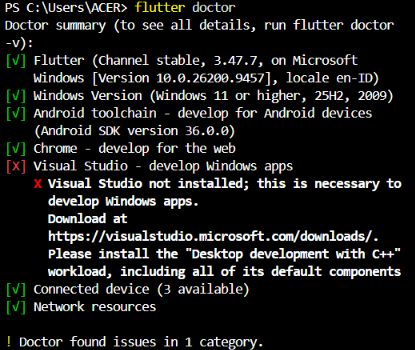
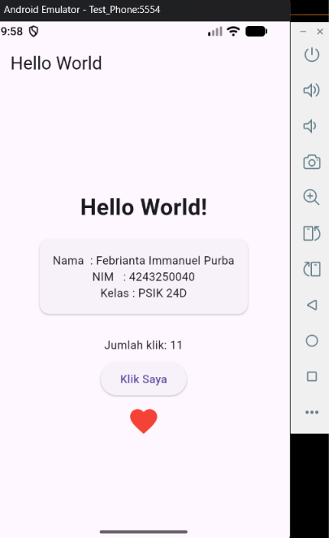

# pm-pertemuan-01-4243250040

Nama: Febrianta Immanuel Purba | NIM: 4243250040 | Kelas: PSIK 24D

## Deskripsi
Aplikasi Flutter sederhana yang menampilkan Hello World beserta nama, NIM, kelas, 
dan widget tambahan berupa Card, tombol penghitung (ElevatedButton), dan ikon.

## Versi Flutter
Flutter 3.47.7 • channel stable • https://github.com/flutter/flutter.git
Framework • revision abaf9c5237 (11 days ago) • 2026-10-08 09:51:21 -0700
Engine • hash d8a2d6c768c334d53e16277f837970ffa1e2de81 (revision deb287481e) (12 days ago) • 2026-10-07 17:09:12.000Z
Tools • Dart 3.13.5 • DevTools 2.60.0

## Tangkapan Layar
### flutter doctor

### Aplikasi

## Kendala dan Solusi
1. **Kendala:** perintah `flutter` tidak dikenali di PowerShell.
   **Solusi:** mengekstrak Flutter SDK ke folder tanpa spasi, menambahkan folder `flutter\bin` ke PATH, lalu membuka ulang terminal.
2. **Kendala:** build Android gagal dengan error `Android sdkmanager did not install NDK 28.2.13676358` karena folder NDK rusak (tidak ada `source.properties`).
   **Solusi:** menghapus folder NDK yang rusak, lalu memasang ulang lewat Android Studio (SDK Manager, SDK Tools, NDK Side by side) sampai selesai.

## Pernyataan Penggunaan AI
Saya menggunakan Claude sebagai asisten untuk panduan instalasi Flutter, 
memperbaiki error build (PATH, Android SDK, NDK), dan contoh kode awal. 
Semua perintah saya jalankan sendiri, kode saya sesuaikan dengan identitas saya, 
dan saya memahami fungsi widget yang dipakai.